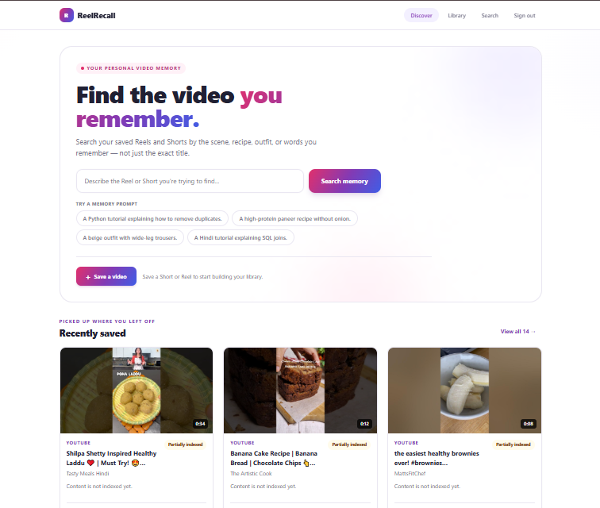

# ReelRecall

<div align="center">

### Your videos are saved. Now make them findable.

ReelRecall is a personal library for saving short videos and finding them again
by what you remember — a recipe, a scene, an outfit, or something someone said.
Search your saved YouTube Shorts and Instagram Reels without needing to recall
the exact title.

**Save it once. Find it by memory.**

</div>

---

## Take a look

### Discover videos by describing what you remember



### Keep your saved Shorts and Reels together

.png)

## What you can do

- **Save links** to YouTube Shorts and Instagram Reels in your personal library.
- **Search in your own words** using details such as a recipe, visual scene, or
  spoken explanation.
- **Index video evidence** such as transcripts and visual descriptions when the
  corresponding providers and dependencies are configured.
- **See why a result matched**, including its evidence source and any available
  timestamp.
- **Track indexing status** and re-index individual videos or your library.
- **Keep accounts separate**: library and search operations are scoped to the
  signed-in user.

ReelRecall is an evolving MVP. Search quality depends on which videos have
searchable extracted content and which optional providers are configured.
Metadata fallback is available when content evidence is missing; it is not a
substitute for indexing the video.

## Run locally on Windows

### Requirements

- Python and `pip`
- Node.js and npm
- Docker Desktop (for PostgreSQL)
- FFmpeg on `PATH` for media download and frame extraction

### 1. Configure the backend

From the project folder, create a fresh signing secret:

```powershell
$bytes = New-Object byte[] 32
[Security.Cryptography.RandomNumberGenerator]::Create().GetBytes($bytes)
$secret = [Convert]::ToBase64String($bytes)
$secret
```

Add the generated value to the root `.env` file:

```dotenv
JWT_SECRET=replace-with-the-generated-value
```

Replace the example value with the generated value. If `.env` already exists,
preserve its other settings and add or update `JWT_SECRET`. Never commit `.env`
or share its contents.

### 2. Start the database and prepare the backend

In PowerShell, from the project folder:

```powershell
docker compose up -d db
cd backend
python -m venv .venv
.\.venv\Scripts\Activate.ps1
pip install -r requirements.txt
alembic upgrade head
```

If PowerShell blocks virtual-environment activation, follow the Python
documentation for enabling script execution for your user, or run the
environment's activation script from Command Prompt instead.

### 3. Start the API and web app

Open two terminals. In the first, start the API:

```powershell
cd backend
.\.venv\Scripts\Activate.ps1
uvicorn app.main:app --reload --host 0.0.0.0 --port 8000
```

In the second, start the frontend:

```powershell
cd frontend
npm install
npm run dev
```

Open the local address printed by Vite in the frontend terminal, create an
account, and start saving videos.

## Search and indexing

Semantic search uses
`sentence-transformers/paraphrase-multilingual-MiniLM-L12-v2` by default. The
first startup may take longer while the model downloads and warms up. You can
change the model with `EMBEDDING_MODEL`.

Transcript generation uses `faster-whisper` when configured. Visual
descriptions use Transformers when `VISION_MODEL` is configured. OCR requires
EasyOCR; summaries require a configured summary provider. Optional stages that
are unavailable are reported as unsupported rather than treated as completed.
After installing a provider or FFmpeg, use the re-index controls to process
videos already in your library.

For remote media, ReelRecall downloads only when permission is explicitly
marked **owned** or **authorized**. Local media can be indexed without a remote
download. Make sure you have the right to access and process any media you add.

## Project layout

| Path | Purpose |
| --- | --- |
| `backend/` | FastAPI API, database models, indexing, and retrieval |
| `frontend/` | React, TypeScript, and Vite web app |
| `docs/` | Product, architecture, API, and evaluation documentation |
| `dataset/` | Dataset manifest and local dataset workflow |
| `evaluation/` | Evaluation instructions and local relevance workflow |
| `scripts/` | Dataset and retrieval utilities |
| `docker-compose.yml` | Local PostgreSQL service |

## Evaluation

See [evaluation/README.md](./evaluation/README.md) for the local retrieval
evaluation workflow. The repository does not include a measured quality
baseline or a public set of relevance judgments.

## Contributing

Issues and pull requests are welcome. Please avoid committing `.env`, private
media, downloaded datasets, or personal evaluation judgments.
